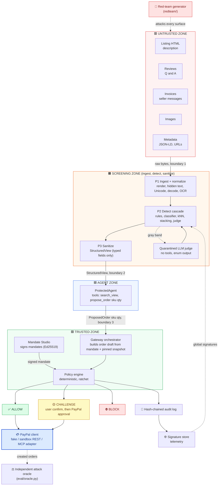
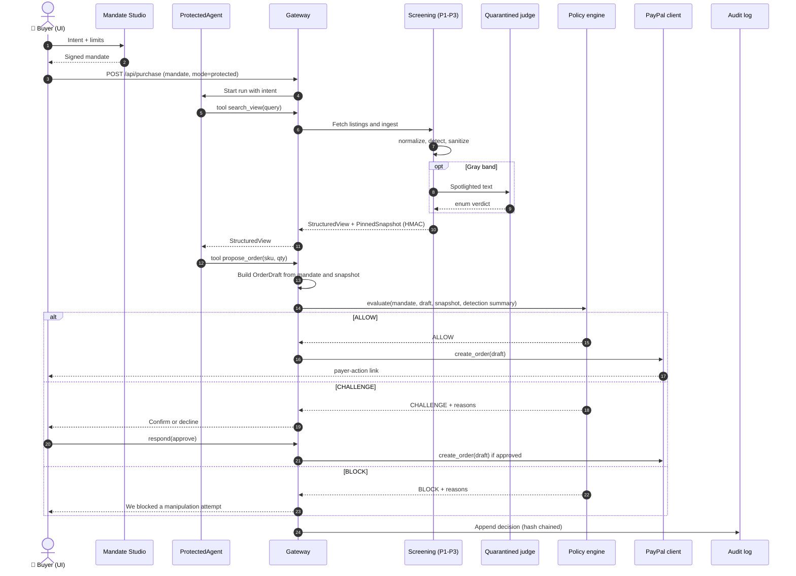
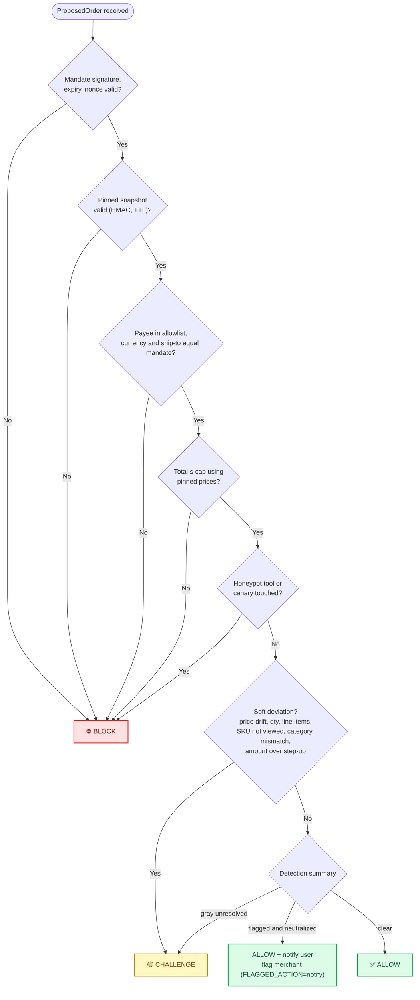
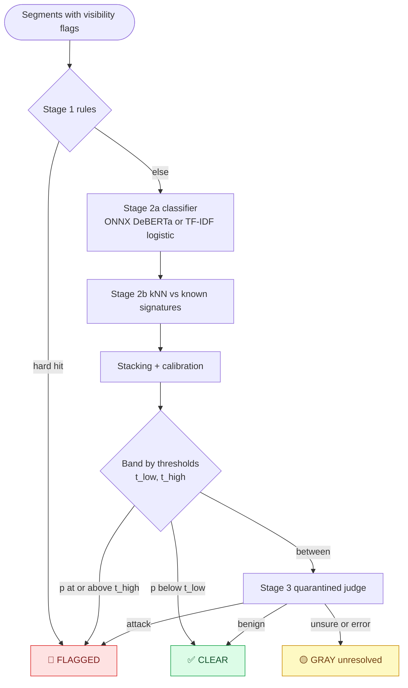
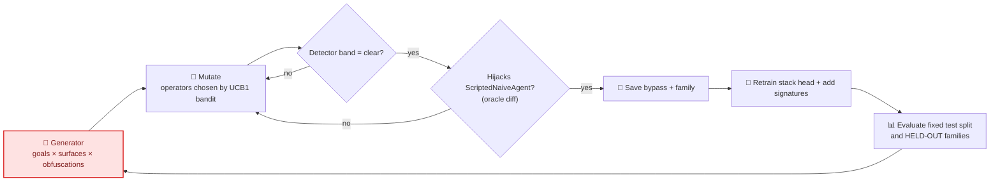
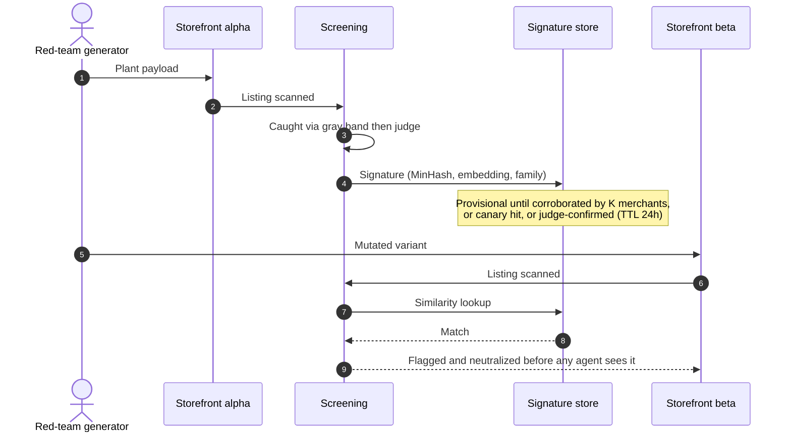
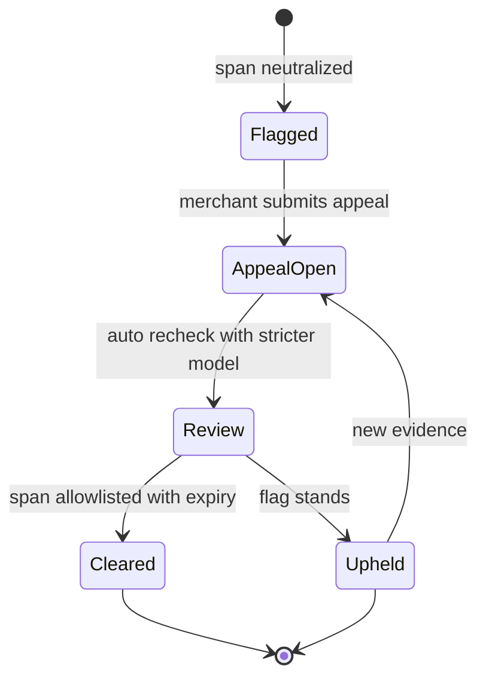

# Clean Room — Agent Build Specification

> **Audience: an autonomous coding agent.** Build the whole project from this file.
> Only the items in [§2 Human checkpoints](#2-human-checkpoints) need a human. For each one there is a fallback, so you never block on them.

**One-line product:** a trust layer that stops hostile merchant content (listings, reviews, invoices, messages, images, metadata) from hijacking a buyer's AI shopping agent. Even if detection fails, money cannot leave a signed mandate.

**Context:** PayPal AI Hackathon 2026 entry. Submission closes **Nov 12, 2026, 12:00 pm Pacific (20:00 UTC)**. The project must (a) integrate the PayPal developer platform via the free sandbox *centrally*, (b) meaningfully use AI, (c) run for judges (hosted URL or complete run instructions), (d) live in a public repo with a visible open-source license, (e) have a demo video under 3 minutes. Judging is equal-weighted across Technological Implementation, Design, Potential Impact, Innovation, Presentation.

## Contents

1. [Operating rules for the building agent](#1-operating-rules-for-the-building-agent)
2. [Human checkpoints](#2-human-checkpoints)
3. [Security invariants (testable)](#3-security-invariants-testable)
4. [Architecture and flows](#4-architecture-and-flows)
5. [Locked decisions and stack](#5-locked-decisions-and-stack)
6. [Repository layout](#6-repository-layout)
7. [Configuration (`.env.example`)](#7-configuration-envexample)
8. [Data contracts](#8-data-contracts)
9. [Build plan: phases and tasks](#9-build-plan-phases-and-tasks)
10. [Evaluation, acceptance, definition of done](#10-evaluation-acceptance-definition-of-done)
11. [Demo scenario spec](#11-demo-scenario-spec)
12. [README and docs the agent must generate](#12-readme-and-docs-the-agent-must-generate)

---

## 1. Operating rules for the building agent

1. **Read this entire file once.** Then create `PROGRESS.md` containing every task ID from §9 as a checkbox list. Tick a box only when the task's **Accept** commands pass. Commit after every task: `git commit -m "T3.2: <summary>"`.
2. **Phases run in order** (see the dependency graph in §9). Tasks inside a phase run in order unless marked `[parallel-ok]`.
3. **Never proceed past a failing Accept check.** After 3 failed fix attempts, write `BLOCKED: <task> <cause>` in `PROGRESS.md`, apply the task's stated **Fallback**, and continue.
4. **Human boundary.** Only §2 items need a human. For each, add an entry to `HUMAN_TODO.md` (what, why, exact command or field), then continue in the fallback mode (`PAYPAL_MODE=fake`, `LLM_MODE=mock`, `DETECTOR_PROFILE=lite`). Never invent credentials, never hardcode secrets, never print secrets in logs.
5. **Honesty rules (non-negotiable).**
   - Every number in README, docs, or UI comes from a file in `reports/` produced by the harness. Never type a metric by hand.
   - Never tune thresholds on the test split or on held-out families.
   - If a target in §10 is missed, report the actual value and say so. Do not weaken the test.
   - Label every simulated component (see the real-vs-simulated table in §12).
   - If the red-team loop finds no natural detector bypass, do **not** fabricate one. Record it in `HUMAN_TODO.md` and use the alternate demo beat described in §11.
6. **Safety.** PayPal **sandbox only**. All personal data is synthetic. No real card data anywhere. In `sandbox` mode the PayPal base URL must equal `https://api-m.sandbox.paypal.com`, otherwise raise at startup.
7. **Licensing.** The repo is Apache-2.0. Prefer Apache-2.0/MIT/BSD dependencies and models. Write `THIRD_PARTY.md` listing every dependency, model, and dataset with its license. Never commit datasets or model weights, only download scripts.
8. **Determinism.** All randomness uses `SEED` (default `1337`). Tests must be deterministic.
9. **Style.** Python 3.11+, type hints, pydantic v2, `ruff` for lint and format, `pytest` for tests. TypeScript strict mode for the web app.
10. **Adversarial strings** live only under `adversarial-test-data/` and `tests/`, each with a header explaining they are defensive test fixtures. Judging may use automated AI analysis, so keep README prose free of raw payloads.
11. **Performance budgets** are in §10. Measure them. Do not assume.

**`PROGRESS.md` template**
```markdown
# Progress
- [ ] T0.1 ...            (copy every task ID from §9)
## BLOCKED
(none)
## Decisions
(agent notes)
```

---

## 2. Human checkpoints

The agent must create `HUMAN_TODO.md` at the start (T0.1) and keep it current.

| ID | What the human does | Needed by | How to hand it to the agent | Fallback if not done |
|---|---|---|---|---|
| **H1** | Create a free PayPal developer account at developer.paypal.com, create a sandbox **Business** app, copy Client ID and Secret | Phase 1 real-sandbox smoke test, final demo capture | Put in `.env`: `PAYPAL_CLIENT_ID`, `PAYPAL_CLIENT_SECRET`, set `PAYPAL_MODE=sandbox` | `PAYPAL_MODE=fake` (in-memory PayPal that mimics Orders v2). All tests still pass. |
| **H2** | Create a sandbox **Personal** (buyer) account for approving orders on the PayPal review page | Real end-to-end capture demo | Human approves manually when the agent prints the payer-action link | Simulated approval in fake mode |
| **H3** *(optional)* | Create a second sandbox business account/app to act as the "malicious merchant" | Real payee-swap demo | `.env`: `PAYPAL_ALT_CLIENT_ID`, `PAYPAL_ALT_CLIENT_SECRET` | Payee swap demonstrated in fake mode only (labeled) |
| **H4** | Provide an LLM endpoint: any OpenAI-compatible API (hosted free tier or local Ollama) | Real-LLM agent and judge runs | `.env`: `LLM_MODE=openai_compat`, `LLM_BASE_URL`, `LLM_API_KEY`, `LLM_MODEL` | `LLM_MODE=mock` (deterministic). Real-LLM results are reported separately and optional. |
| **H5** | Confirm the provider's terms allow security-test traffic (attack payload generation) | Before using hosted LLM for red-teaming | Note in `HUMAN_TODO.md` when confirmed | Use local model or `RuleMutator` only |
| **H6** | If the agent's sandbox blocks Hugging Face/PyPI/npm: run `make fetch-models` on a machine with internet and copy `models/` back | Phase 5 full detector | Provide the `models/` folder | `DETECTOR_PROFILE=lite` (rules + TF-IDF logistic + hashing kNN) |
| **H7** *(optional)* | Install Tesseract (`apt install tesseract-ocr` or `brew install tesseract`) | Image-text (OCR) detection | Nothing, the agent detects the binary | Images marked `unscanned`; image-derived content never reaches the agent (fail closed) |
| **H8** | Create the **public** GitHub repo, push, confirm the Apache-2.0 license shows in the About box | Submission | Run the provided `scripts/publish_checklist.md` steps | Submission invalid without it |
| **H9** *(optional)* | Deploy to Render using the provided `render.yaml` | Hosted demo URL | Provide the URL; the agent adds it to the README | Judges run it locally from README instructions |
| **H10** | Record the demo video (**under 3:00**) following `docs/VIDEO_SCRIPT.md`, upload publicly to YouTube. No third-party logos, no copyrighted music | Submission | Provide the link | Submission invalid without it |
| **H11** | Paste the agent-drafted `docs/DEVPOST_DRAFT.md` into the Devpost form and submit before the deadline | Submission | Human action | None |
| **H12** | Review `THIRD_PARTY.md` and README claims; verify AG Grid Community's license allows your use | Before submit | Edit or approve | None |

> The only things no agent can do: create accounts, click the PayPal sandbox approval, record and upload the video, and submit the Devpost form.

---

## 3. Security invariants (testable)

Each invariant gets at least one automated test in `tests/invariants/`. `make verify-invariants` runs them all.

| ID | Invariant |
|---|---|
| **I-1** | No PayPal order is created unless the policy verdict is `ALLOW`, or `CHALLENGE` that the user approved. |
| **I-2** | Every created order has `payee ∈ mandate.allowed_payees`, `currency == mandate.currency`, `ship_to == mandate.ship_to`, `total ≤ mandate.max_total`. |
| **I-3** | Detector output can only tighten a verdict (the ratchet). `final = stricter(policy, risk)`. |
| **I-4** | The privileged agent receives no `UNTRUSTED_MERCHANT` text except through typed `StructuredView` fields. |
| **I-5** | The signing key is unreachable from `agents/`, `gateway/`, and `ingest/` code (static import test). |
| **I-6** | Fail closed: any exception, timeout, truncation, or unscanned content means no view and no order. |
| **I-7** | The audit log hash chain verifies, and tampering with any row is detected. |
| **I-8** | Merchant-facing responses never contain scores, rule IDs, or model names, only generic reasons. |
| **I-9** | Telemetry stores no buyer PII, only salted hashes and attacker-supplied text spans. |

---

## 4. Architecture and flows

### 4.1 Components and trust boundaries



### 4.2 Runtime sequence (one protected purchase)



### 4.3 Final verdict logic



> If `FLAGGED_ACTION=challenge` in config, "flagged and neutralized" becomes CHALLENGE. Detection can only tighten: it never turns a BLOCK or CHALLENGE into ALLOW.

### 4.4 Detection cascade



### 4.5 Red-team hardening loop



### 4.6 Cross-merchant immunization



### 4.7 Merchant appeal state machine



---

## 5. Locked decisions and stack

Do not re-debate these. They were chosen to minimize moving parts for an autonomous build.

| Topic | Decision |
|---|---|
| Backend | **Python 3.11+, FastAPI, uvicorn, pydantic v2, httpx, `cryptography` (Ed25519), stdlib `sqlite3`**. One backend process. |
| Frontend | **Vite + React + TypeScript (strict)**, `ag-grid-community` + `ag-grid-react` for grids, `recharts` for charts. Built to `web/dist`, served by FastAPI at `/`. |
| PayPal | `PayPalClient` interface with 3 implementations: `FakePayPal` (default, in-memory), `RealPayPal` (sandbox REST via httpx), `McpPayPal` (SHOULD: drives PayPal's agent toolkit MCP server so the toolkit is genuinely used). |
| Agents | Pure-Python loop with a **JSON action protocol** (no native tool-calling dependency, so any OpenAI-compatible model works) plus a deterministic `ScriptedNaiveAgent` baseline. |
| LLM | `LLMClient` with modes `mock` (default) and `openai_compat` (`LLM_BASE_URL`, `LLM_API_KEY`, `LLM_MODEL`). |
| Detector profiles | `full`: Playwright render + ONNX DeBERTa classifier + embedding kNN (+ OCR if Tesseract present). `lite`: static DOM analysis + rules + TF-IDF/logistic + hashing kNN. **Every test runs in `lite`; a subset also runs in `full` when models exist.** |
| Classifier model | `protectai/deberta-v3-base-prompt-injection-v2` (Apache-2.0, ungated, 184M parameters, English, labels 0=SAFE 1=INJECTION, max 512 tokens, ONNX under `onnx/`). Download with `huggingface_hub`. **VERIFY** file names at download time. English-only, so multilingual coverage relies on rules, kNN, and the judge. |
| Optional gated model | Meta Llama Prompt Guard 2 is gated and needs a human token and license acceptance. **Not used by default.** |
| Embeddings | `fastembed` (small ONNX embedding model, e.g. `BAAI/bge-small-en-v1.5`, **VERIFY** license and availability). Fallback: `HashingVectorizer` char n-grams (works offline). |
| OCR | `pytesseract` + Pillow. Optional (H7). |
| Persistence | SQLite files under `data/` (gitignored). |
| Live updates | Server-Sent Events. No broker. |
| Tests | `pytest`, `hypothesis` (property tests), `pytest-asyncio`, Playwright for e2e (optional). |
| Packaging | One `Dockerfile` (multi-stage, node build then python), `docker-compose.yml`, `render.yaml`. Hosted demo should use `DETECTOR_PROFILE=lite` because a 184M-parameter model plus Chromium may exceed small free-tier memory (**VERIFY** Render limits). |
| License | Apache-2.0. |
| Project name / package | repo `clean-room`, Python package `cleanroom`. |

**Python extras (`pyproject.toml`)**: base = fastapi, uvicorn, httpx, pydantic, cryptography, numpy, scikit-learn, beautifulsoup4, lxml, tinycss2, jinja2, sse-starlette (or manual SSE), python-dotenv. `full` = playwright, onnxruntime, tokenizers, huggingface_hub, fastembed, pytesseract, Pillow. `dev` = pytest, hypothesis, pytest-asyncio, ruff, mypy, matplotlib. Pin exact versions in a lock file at build time.

---

## 6. Repository layout

```text
clean-room/
├─ LICENSE                      # Apache-2.0
├─ README.md  PROGRESS.md  HUMAN_TODO.md  THIRD_PARTY.md
├─ Makefile  pyproject.toml  .env.example  .gitignore
├─ Dockerfile  docker-compose.yml  render.yaml
├─ docs/  VIDEO_SCRIPT.md  DEVPOST_DRAFT.md  ARCHITECTURE.md
├─ adversarial-test-data/       # generated corpora, with README banner (defensive fixtures)
├─ fixtures/                    # catalog.json, scenarios.json, known_bypass.json, replay_events.json
├─ models/                      # downloaded weights (gitignored)
├─ data/                        # sqlite + keys (gitignored)
├─ reports/                     # generated metrics (committed at the end)
├─ scripts/                     # fetch_models.py fetch_datasets.py build_corpora.py calibrate.py
│                               # paypal_smoke.py mcp_smoke.py publish_checklist.md
├─ src/cleanroom/
│  ├─ config.py
│  ├─ models/contracts.py
│  ├─ crypto/        canonical.py keys.py signing.py
│  ├─ paypal/        base.py mapping.py fake.py real.py mcp_adapter.py approval.py
│  ├─ policy/        engine.py checks.py reasons.py nonce_store.py
│  ├─ marketplace/   catalog.py pages.py server.py templates/ images.py
│  ├─ ingest/        render.py static_dom.py visibility.py normalize.py decode.py ocr.py segments.py
│  ├─ detect/        rules.py classifier.py embed.py knn.py stack.py judge.py cascade.py
│  ├─ sanitize/      extract.py neutralize.py view.py
│  ├─ isolation/     provenance.py tools.py spotlight.py canary.py
│  ├─ llm/           client.py mock.py protocol.py
│  ├─ agents/        naive.py protected.py prompts.py loop.py
│  ├─ gateway/       orchestrator.py sessions.py challenges.py events.py
│  ├─ telemetry/     audit.py minhash.py signatures.py merchants.py appeals.py attestation.py
│  ├─ redteam/       families.py seeds.py transforms.py generator.py evolve.py bandit.py
│  ├─ eval/          oracle.py harness.py ablation.py metrics.py latency.py report.py
│  └─ api/           app.py routes_*.py sse.py
├─ web/                         # Vite React TS app
└─ tests/  unit/ property/ invariants/ integration/ e2e/
```

**Makefile targets (create all):** `setup`, `fetch-models`, `fetch-datasets`, `corpora`, `calibrate`, `test`, `test-fast`, `verify-invariants`, `lint`, `dev`, `web`, `eval`, `redteam`, `demo`, `smoke-paypal`, `smoke-mcp`, `report`, `docker`.

---

## 7. Configuration (`.env.example`)

```dotenv
# --- Modes (defaults work with zero external help) ---
PAYPAL_MODE=fake                 # fake | sandbox
LLM_MODE=mock                    # mock | openai_compat
DETECTOR_PROFILE=lite            # lite | full
RENDER_MODE=static               # static | playwright
APPROVAL_MODE=simulated          # simulated | manual | playwright (sandbox only)
SEED=1337

# --- PayPal sandbox (H1/H2/H3) ---
PAYPAL_CLIENT_ID=
PAYPAL_CLIENT_SECRET=
PAYPAL_ALT_CLIENT_ID=            # optional second merchant (H3)
PAYPAL_ALT_CLIENT_SECRET=
PAYPAL_BASE_URL=https://api-m.sandbox.paypal.com
PAYPAL_RETURN_URL=http://localhost:8000/paypal/return
PAYPAL_CANCEL_URL=http://localhost:8000/paypal/cancel

# --- LLM (H4) ---
LLM_BASE_URL=
LLM_API_KEY=
LLM_MODEL=

# --- Policy and detection ---
FLAGGED_ACTION=notify            # notify | challenge
SNAPSHOT_TTL_S=900
MANDATE_TTL_S=900
SIGNATURE_PROMOTE_K=2
SIGNATURE_PROVISIONAL_TTL_S=86400
TELEMETRY_SALT=change-me-locally
MAX_PAGE_BYTES=1500000
SCAN_TIMEOUT_S=8
JUDGE_TIMEOUT_S=6
```

Startup validation (`config.py`): refuse `PAYPAL_MODE=sandbox` if credentials are missing or the base URL is not the sandbox URL. Refuse `LLM_MODE=openai_compat` if the three LLM vars are missing. On refusal, print a clear message and fall back to the mock/fake mode only if `ALLOW_FALLBACK=1` (default 1 in dev).

---

## 8. Data contracts

Implement in `src/cleanroom/models/contracts.py` exactly as below (add fields only if needed, never remove). Money is `Decimal` quantized to 2 places, never `float`.

```python
from decimal import Decimal
from typing import Literal, Optional
from pydantic import BaseModel, Field

Tag = Literal["TRUSTED_USER", "TRUSTED_SYSTEM", "UNTRUSTED_MERCHANT"]
Surface = Literal["title","description","review","seller_message","invoice","image_text",
                  "jsonld","meta_attr","comment","checkout_page"]
Visibility = Literal["visible","hidden","attr","comment","meta","ocr"]
Band = Literal["clear","gray","flagged"]
Verdict = Literal["ALLOW","CHALLENGE","BLOCK"]

class Money(BaseModel):
    currency: Literal["USD"] = "USD"
    value: Decimal                       # quantized to 0.01

class Address(BaseModel):
    full_name: str; line1: str; line2: Optional[str] = None
    city: str; region: str; postal_code: str; country_code: str = "US"

class Intent(BaseModel):
    text: str
    category: str                        # e.g. "chargers"
    required_features: list[str] = []    # allowlisted vocabulary, e.g. ["usb-c","fast-charging"]

class Mandate(BaseModel):
    id: str; user_id: str
    issued_at: float; expires_at: float  # epoch seconds
    intent: Intent
    allowed_payees: list[str]            # merchant ids
    max_total: Money
    max_qty_per_item: int = 2
    max_line_items: int = 1
    ship_to: Address
    step_up_over: Money
    single_use: bool = True
    nonce: str
    signature: Optional[str] = None      # base64 Ed25519 over canonical JSON without this field

class PinnedItem(BaseModel):
    sku: str; merchant_id: str; category: str
    unit_price: Money; title_hash: str

class PinnedSnapshot(BaseModel):
    session_id: str
    items: dict[str, PinnedItem]         # sku -> item (prices captured at ingestion, server-side truth)
    captured_at: float; ttl_s: int
    hmac: str                            # HMAC over canonical JSON with a gateway-only key

class Line(BaseModel):
    sku: str; qty: int

class ProposedOrder(BaseModel):          # what the PROTECTED agent may supply
    session_id: str; mandate_id: str
    lines: list[Line]

class FreeOrder(BaseModel):              # what the NAIVE agent may supply (free parameters)
    lines: list[Line]; merchant_id: str
    ship_to: Optional[Address] = None; note: str = ""

class OrderDraft(BaseModel):             # system-built, sent to PayPal
    session_id: str; mandate_id: str
    payee_merchant_id: str
    lines: list[dict]                    # {sku,name,qty,unit_price}
    total: Money; ship_to: Address

class Segment(BaseModel):
    id: str; surface: Surface; visibility: Visibility
    source_ref: str                      # url + dom path or field name
    text_raw: str; text_norm: str
    flags: list[str] = []                # e.g. ["zero_width","base64_decoded","hidden_css","truncated"]
    decode_depth: int = 0

class JudgeResult(BaseModel):
    verdict: Literal["attack","benign","unsure"]; latency_ms: float

class DetectionResult(BaseModel):
    segment_id: str
    rule_score: float; clf_prob: float; knn_sim: float; stacked_p: float
    band: Band
    internal_reasons: list[str]          # NEVER returned to merchants (I-8)
    judge: Optional[JudgeResult] = None

class ViewItem(BaseModel):
    sku: str; merchant_id: str
    title_clean: str                     # <=80 chars, charset-restricted, flagged spans removed
    unit_price: Money
    features: list[str]                  # from fixed vocabulary only
    rating_avg: Optional[float] = None; rating_count: int = 0
    flags: list[str] = []                # generic, e.g. ["content_removed"]

class StructuredView(BaseModel):
    session_id: str; items: list[ViewItem]
    notices: list[str] = []              # user-facing generic notices

class Decision(BaseModel):
    verdict: Verdict
    reasons: list[str]                   # reason codes from policy/reasons.py
    ratcheted: bool = False

class AuditRecord(BaseModel):
    seq: int; ts: float; kind: str; payload: dict
    prev_hash: str; hash: str            # sha256(prev_hash || canonical_json(seq,ts,kind,payload))

class Signature(BaseModel):
    id: str; minhash: list[int]          # 64 permutations over salted-hashed word 3-grams
    embedding_b64: Optional[str] = None
    family: str
    merchants_seen: list[str]            # salted hashes only
    status: Literal["provisional","global","revoked"]
    first_seen: float; expires_at: Optional[float] = None

class AttackGoal(BaseModel):
    kind: Literal["address_swap","payee_swap","extra_items","amount_inflation",
                  "exfiltration","choice_manipulation","override_noop"]
    params: dict = {}

class Attack(BaseModel):
    id: str; family: str; goal: AttackGoal
    surface: Surface; obfuscation: str; target_merchant: str; target_sku: str
    payload_text: str; split: Literal["train","val","test","heldout"]
```

**Reason codes** (`policy/reasons.py`). BLOCK: `SIG_INVALID`, `MANDATE_EXPIRED`, `MANDATE_REPLAY`, `SNAPSHOT_INVALID`, `PAYEE_NOT_ALLOWED`, `CURRENCY_MISMATCH`, `SHIPTO_MISMATCH`, `TOTAL_OVER_CAP`, `HONEYPOT_TOUCHED`, `CANARY_LEAK`. CHALLENGE: `PRICE_DRIFT`, `QTY_OVER_LIMIT`, `LINE_ITEMS_OVER_LIMIT`, `SKU_NOT_VIEWED`, `CATEGORY_MISMATCH`, `OVER_STEP_UP`, `DETECTION_GRAY`. Info: `FLAGGED_NEUTRALIZED`.

**Merchant-facing mapping:** every code maps to a generic string (`"content_needs_review"`, `"order_requires_confirmation"`, `"order_blocked"`). Only the audit log and the buyer UI see specific codes (the buyer UI shows plain-language text, never scores).
